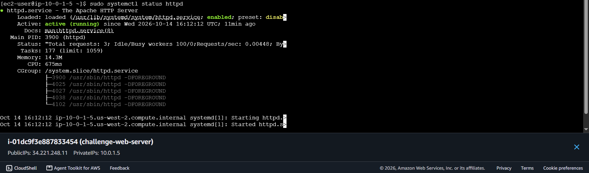

# AWS EC2 Instance Challenge Lab

## Project Overview

This project demonstrates how to deploy a publicly accessible web server on Amazon Web Services (AWS) using Amazon EC2, a custom Virtual Private Cloud (VPC), and Apache HTTP Server.

The lab covers networking, security group configuration, EC2 instance provisioning, user data automation, and hosting a custom HTML webpage.

## Objectives

- Create a custom VPC and subnet.
- Configure an Internet Gateway and route table.
- Configure public IPv4 addressing.
- Create a security group for SSH and HTTP access.
- Launch an Amazon Linux 2023 EC2 instance.
- Automate Apache installation using EC2 user data.
- Connect to the instance using EC2 Instance Connect.
- Host and test a custom HTML webpage.

## AWS Services Used

| Service or Component | Purpose |
|---|---|
| Amazon EC2 | Hosts the web server |
| Amazon VPC | Provides an isolated virtual network |
| Subnet | Places the EC2 instance within the VPC |
| Internet Gateway | Enables internet connectivity for the public subnet |
| Route Table | Routes internet-bound traffic through the Internet Gateway |
| Security Group | Controls inbound and outbound instance traffic |
| EC2 Instance Connect | Provides browser-based access to the instance |
| Apache HTTP Server | Serves the HTML webpage |

## Architecture

```text
Internet
   |
   v
Internet Gateway
   |
   v
Route Table
   |
   v
Public Subnet: 10.0.1.0/24
   |
   v
Security Group
   |  SSH: TCP 22 (restricted to my IP)
   |  HTTP: TCP 80 (public)
   v
Amazon EC2 Instance
Amazon Linux 2023 | t3.micro
   |
   v
Apache HTTP Server
   |
   v
projects.html
```

## Network Configuration

| Component | Configuration |
|---|---|
| VPC Name | Challenge-VPC |
| VPC IPv4 CIDR | 10.0.0.0/16 |
| Subnet Name | Challenge-Subnet |
| Subnet IPv4 CIDR | 10.0.1.0/24 |
| Internet Gateway | Challenge-IGW |
| Route Table | Challenge-Route-Table-2 |
| Security Group | Challenge-Web-SG |

### Route Table

| Destination | Target | Purpose |
|---|---|---|
| 10.0.0.0/16 | local | Allows communication within the VPC |
| 0.0.0.0/0 | Internet Gateway | Routes internet-bound IPv4 traffic through the gateway |

The custom route table was associated with `Challenge-Subnet`.

## EC2 Instance Configuration

- **Instance name:** Challenge-Web-Server
- **Operating system:** Amazon Linux 2023
- **Instance type:** t3.micro
- **Web server:** Apache HTTP Server (`httpd`)
- **Root volume type:** General Purpose SSD (gp2)
- **Public IPv4:** Enabled

## Security Configuration

The security group was configured with the following inbound rules:

| Protocol | Port | Source | Purpose |
|---|---:|---|---|
| TCP | 22 | My IP | SSH administration |
| TCP | 80 | 0.0.0.0/0 | Public HTTP access |

HTTP access was allowed publicly so that visitors could load the webpage. SSH access was restricted to my IP address.

**Security note:** For production environments, prefer HTTPS, use appropriately restricted administrative access, and avoid exposing sensitive services publicly.

## Automating Apache Installation with User Data

The following Bash script was supplied during EC2 instance launch:

```bash
#!/bin/bash
dnf install -y httpd
systemctl enable httpd
systemctl start httpd
chmod 777 /var/www/html
```

The script installs Apache, enables the service at startup, starts it, and changes the web directory permissions.

**Production improvement:** Replace `chmod 777` with appropriately restricted ownership and permissions. World-writable permissions are unnecessary for a typical web server.

## Creating the HTML Webpage

The file was created at `/var/www/html/projects.html`.

```html
<!DOCTYPE html>
<html>
<body>
    <h1>Mary Awino's re/Start Project Work</h1>
    <p>EC2 Instance Challenge Lab</p>
</body>
</html>
```

The webpage was accessed using:

```text
http://YOUR-PUBLIC-IP/projects.html
```

Replace `YOUR-PUBLIC-IP` with the instance's actual public IPv4 address. The address may change if the instance is stopped and restarted unless a persistent address is configured.

## Validation and Testing

The following checks were completed:

1. Confirmed that the EC2 instance was running.
2. Reviewed the instance system log and verified Apache installation.
3. Connected through EC2 Instance Connect.
4. Checked the Apache service using:

   ```bash
   sudo systemctl status httpd
   ```

5. Confirmed that the service reported `active (running)`.
6. Opened the public IP and `/projects.html` path in a browser.
7. Verified that the custom heading and paragraph displayed successfully.

## Screenshots and Evidence

Add your screenshots to a folder named `screenshots/` in this repository.

Suggested structure:

```text
aws-ec2-instance-challenge-lab/
├── README.md
└── screenshots/
    ├── 01-ec2-httpd-installation.png
    ├── 02-ec2-projects-webpage.png
    ├── 03-ec2-instance-configuration.png
    ├── 04-challenge-vpc.png
    ├── 05-challenge-subnet.png
    ├── 06-challenge-route-table.png
    ├── 07-challenge-internet-gateway.png
    ├── 08-challenge-security-group.png
    ├── 09-httpd-service-running.png
    └── 10-projects-webpage-final.png
```

Screenshot filenames above are suggested names. Use the actual filenames you saved, and include the Internet Gateway screenshot only if you captured it.

After uploading the images, you can display them in this README using Markdown, for example:

```markdown

```

## Key Learnings

- How VPCs and subnets organize AWS network resources.
- How Internet Gateways and route tables enable public IPv4 connectivity.
- How security groups control traffic to EC2 instances.
- How EC2 user data automates software installation and configuration.
- How to administer an instance through EC2 Instance Connect.
- How to host and validate a webpage using Apache HTTP Server.

## Conclusion

This hands-on challenge provided practical experience deploying and validating a public web server on AWS. It strengthened my understanding of EC2 provisioning, VPC networking, access control, and basic Linux web server administration.

**Project:** AWS EC2 Instance Challenge Lab  
**Author:** Mary Awino  
**Program:** AWS re/Start

